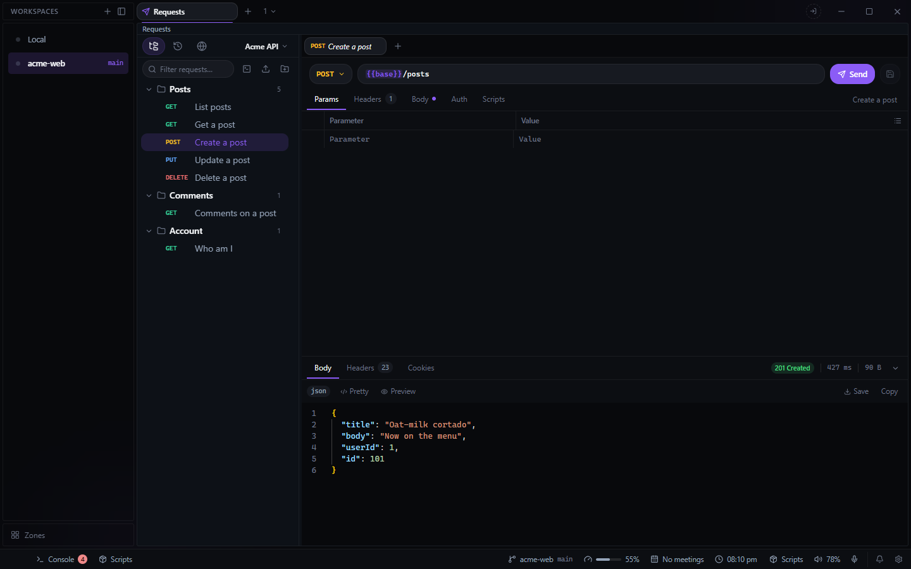

# Requests for Deck

A Postman-style HTTP client in a pane. Open it from the **+** beside your tabs and choose
**Requests**.

- **Collections and folders** of saved requests, inside switchable **workspaces**.
- A JSON, text or form body, and Bearer or Basic auth (an `Authorization` header you set yourself
  wins over it).
- **Environments** with `{{variables}}`, plus dynamic values such as `{{$guid}}` and
  `{{$timestamp}}`.
- **Pre-request and post-response scripts** (a `pm`-style API, run in a sandboxed worker) for
  tests and token refreshes.
- **cURL** import (paste one into the URL bar) and copy as cURL, with `{{variables}}` as written
  or filled in.
- **Export and import** a collection or a whole workspace as a JSON file, with or without its
  secrets.
- **History** of the last 200 requests sent.
- **Shared workspaces**: share a workspace with a Deck team (Settings > Teams) from the workspace
  menu, and every member keeps it in step whenever they are online together. Environment values,
  auth tokens and passwords, and credential headers (Authorization, Cookie, X-Api-Key) stay on
  each Deck unless they are only a `{{variable}}`; history is never shared. A shared workspace
  has the team icon in the workspace menu. Only whoever shared it and the team's owner can stop
  sharing it (everyone keeps a copy) or delete it for everyone; the others can edit and rename it.
- Ctrl+Enter sends, Ctrl+S saves, F2 renames. Each can be rebound in Settings > Keybindings.

Requests are sent by Deck itself, not the browser, so there is no CORS, with a 10 MB response cap,
a 60 second timeout and a Cancel button.

Data lives in `data\requests\` in Deck's config folder on this machine:
`requests-collections.json` and `requests-history.json`. A backup includes the collections; the
history is left out because it holds every request sent, credentials included.

## For agents

The plugin brings `requests_*` tools to Deck's MCP server: `requests_list`, `requests_send` and
`requests_get_request`, and tools to add, update, rename, move, duplicate and delete requests,
folders, workspaces and environments, set variables and switch the active workspace or
environment. Secrets come back masked unless **Reveal secrets to MCP** is on in Settings >
Plugins > Requests.

Requests was Deck's built-in HTTP tab until 1.1. Deck renames the old `http-*` files to the
plugin's the first time it starts, so everything saved there is here.
